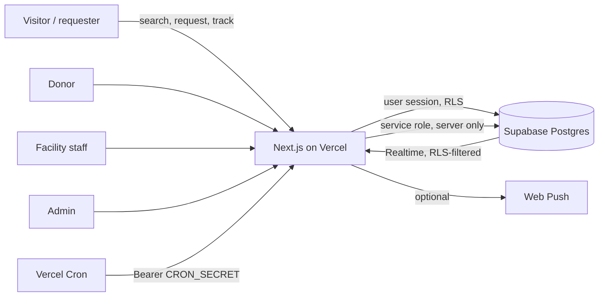

# Architecture



## Layers

- **Domain (`src/lib/domain`)**: pure TypeScript with no I/O: blood rules, distance, freshness policy, request state machine, matching engine, availability search, validation schemas, tracking tokens. Fully unit-tested.
- **Database (`supabase/migrations`)**: tables, RLS, and `SECURITY DEFINER` functions that perform every privileged write transactionally (`set_inventory`, `centre_respond`, `fulfil_request`, `respond_to_match`, `close_request`, ...). The browser never writes inventory or request state directly.
- **Server (`src/lib/server`, `src/actions`)**: server actions validate input with Zod, check the caller's role, then call the database functions using the **user's own session** so RLS and in-function checks apply. Only request creation, matching, maintenance, push and admin metrics use the service role.
- **UI (`src/app`, `src/components`)**: server components load data; small client components handle forms, maps and Realtime refresh.

## Emergency request flow

```mermaid
sequenceDiagram
  participant R as Requester
  participant W as Wizard (client)
  participant S as Server action
  participant DB as Postgres
  participant F as Facility staff
  participant Dn as Donor
  R->>W: 4 steps, validated with Zod
  W->>S: createRequestAction(values, submissionId)
  S->>S: rate limits + idempotency key
  S->>DB: insert request (token hash only) + audit
  S->>S: runMatching (pure engine)
  S->>DB: insert matches with rationale; notify consenting candidates
  S-->>R: tracking link (token shown once)
  Dn->>DB: respond_to_match (accept/decline)
  F->>DB: centre_respond(confirm) reserves units under row lock
  DB-->>R: status availability_confirmed (poll every 15 s)
  F->>DB: fulfil_request deducts stock, releases other reservations
```

States: `submitted → matching → awaiting_response → availability_confirmed → fulfilled`, plus `cancelled`, `expired`, `rejected`, `unresolved`. The same transition table is enforced in TypeScript and by a database trigger; an integration test checks they agree for every pair.

A donor accepting changes only that donor's match row. Only a verified facility's `centre_respond` can move a request to `availability_confirmed`.

## Realtime and notifications

Notifications are persisted rows first. Authenticated dashboards subscribe to `postgres_changes` filtered to the user's own rows (RLS also applies) and simply refresh server data; no record contents travel in the event handler. Anonymous requesters cannot hold a Realtime session, so the tracking page polls a rate-limited, token-keyed endpoint. Web Push is optional; failures retry up to three times and never remove the in-app notification.

## PWA

`manifest.webmanifest`, generated icons, and a service worker that caches only `/_next/static/*`, the icons and `/offline`. Pages, API responses and tracking links always hit the network, so private data and stale stock are never served from cache.
