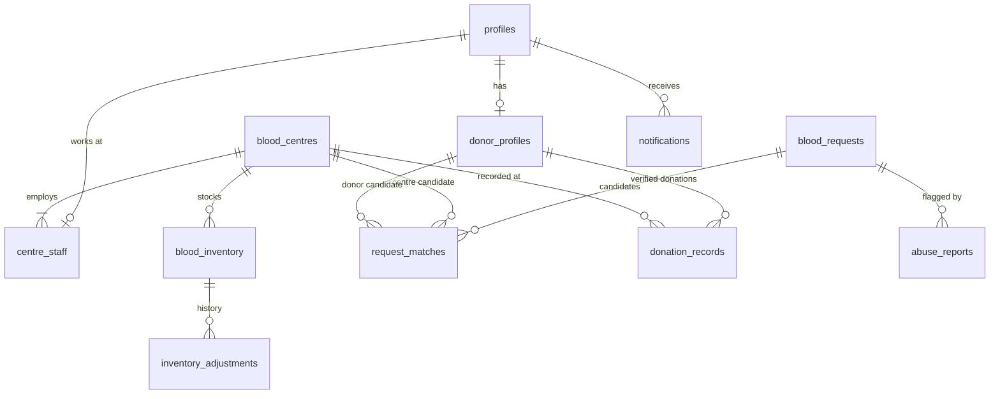

# Database

Migrations: `20260101000001_schema.sql` (tables, constraints, indexes, triggers), `..._rls.sql` (policies and grants), `..._functions.sql` (transactional operations).

## Tables

| Table | Notes |
| --- | --- |
| `profiles` | 1:1 with `auth.users`. `role` (`requester`, `donor`, `staff`, `admin`) and `status` are not user-editable (column grants plus trigger) |
| `donor_profiles` | Self-reported blood group, opt-in with `consent_at`, availability, **coarse** location (2 decimals, about 1 km), `donor_code` |
| `blood_centres` | Verification status `pending / verified / rejected / suspended`, `is_synthetic` flag. `license_ref` and notes are not readable by anon/authenticated roles |
| `centre_staff` | One facility per staff user; `owner` or `staff` |
| `blood_inventory` | Unique per centre, group, component. `units`, `reserved`, `last_confirmed_at`. Check `reserved <= units` |
| `inventory_adjustments` | Append-only history: set, delta, reserve, release, fulfil |
| `blood_requests` | Public tracking uses `tracking_hash` (SHA-256 of an unguessable token); the token is never stored. Contact fields visible only to the requester, matched facility staff and admins |
| `request_matches` | One row per candidate (`centre` or `donor`), score, distance, JSON rationale, response status. Unique per request and candidate, preventing duplicate responses |
| `donation_records` | Written only by verified facility staff via `record_donation` |
| `notifications`, `push_subscriptions` | Per-user |
| `audit_logs` | Append-only (trigger blocks update and delete); admin read |
| `abuse_reports` | Raised by facility staff, handled by admins |
| `rate_limits` | Fixed-window counters used by `check_rate_limit` |

Indexes cover location (`lat,lng`), blood group and component, status and expiry, confirmation time, donor pool, and per-user notification listing.

## Access rules (summary)

| Actor | Can read | Can write |
| --- | --- | --- |
| Anonymous | Verified centres (safe columns) and their inventory | Nothing directly |
| Donor | Own profile, own matches, own notifications and donations | Own donor profile; respond via `respond_to_match` |
| Staff | Own facility, its inventory and history, requests matched to it | Inventory and responses only via RPCs that check verified facility membership |
| Admin | Everything needed for review and audit | Verification via `review_centre`; suspension and report handling through audited server actions |
| Service role | All (bypasses RLS) | Request creation, matching, closing, push |

Internal functions (`log_audit`, `notify_user`, `close_request`, `check_rate_limit`) are revoked from `anon` and `authenticated`.

## Concurrency

Inventory and request rows are locked (`SELECT ... FOR UPDATE`) inside each RPC. `centre_respond` reserves units against `units - reserved`, so two requests cannot be promised the same stock; `fulfil_request` and `close_request` release reservations. See the integration tests for the behaviour verified.
